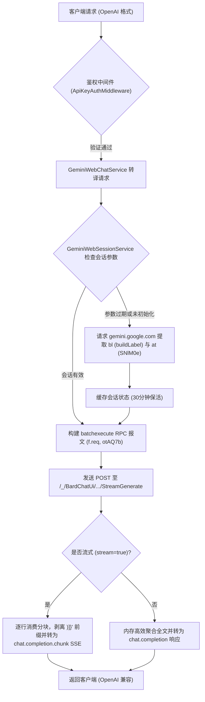

# GeminiWebAgent 🚀

> **基于 .NET 10 技术栈的 Google Gemini Web (`gemini.google.com`) 反向代理与 OpenAI 规范兼容网关**

GeminiWebAgent 是一个专为 AI Agent（Cursor、Dify、LangChain、Cline / Roo Code、Continue、NextChat、Open-WebUI 等）打造的高性能本地/私有网关。它通过深度解析 Google 官方 Web 网页版端点（`https://gemini.google.com`），无缝封装底层的 `batchexecute` RPC 协议，将其转化为完全符合 **OpenAI 官方规范** 的 API 接口：
- `POST /v1/chat/completions` (支持非流式与流式 SSE)
- `GET /v1/models` (列出可用模型列表)
- `GET /v1/health` (服务健康检查)

项目结构、代码规范与工程质量完全对标并严格参考 [`E:\Personal\GeminiAgent`](file:///E:/Personal/GeminiAgent)。

---

## 🌟 核心特性与技术架构

### 1. 🔄 Gemini Web 协议自适应解析 (batchexecute Protocol)
- **动态会话参数嗅探 (`GeminiWebSessionService`)**：Gemini Web 前端依赖动态的后端构建标识（`bl` / `cfb2h`）以及 anti-XSRF 校验凭证（`at` / `SNlM0e`）。GeminiWebAgent 在后台自动从首页 HTML 中高效抽取并缓存参数（30 分钟自适应巡检），彻底规避传统硬编码导致的 HTTP 400/405 失效问题。
- **深层 RPC 报文编解码**：封装 Google `otAQ7b`（`StreamGenerate`）RPC 调用，在 URL-encoded `f.req` 结构中完成提示词与模型标识（Position `[79]`）的注入与序列化。
- **全自动 XSRF 防御剥离**：毫秒级移除响应体起始的 `)]}'` 安全防注入标记，递归解码多维嵌套数组结构，精确提取生成的文本分块。



### 2. 🔑 灵活的多源认证与自动滚动续期 (Cookie Auto-Renewal)
为解决 Linux / Docker 等无头环境下难以人工反复按 F12 复制 Cookie 的痛点，网关设计了内置开关与自动保活机制：
- **开关配置 (`CookieSource`)**：
  - `Manual` *(默认)*：保留原有手工模式，可通过配置文件预设或客户端在 `Authorization: Bearer <cookies>` 头中透传。
  - `File`：从指定文件（如 `cookies.json`）读取，支持 Docker volume 挂载与热重载。
- **Google 滚动 Token 拦截自动回写 (`EnableAutoRenewal = true`)**：
  - Google Web 体系中 `__Secure-1PSID` 为长效主令牌（寿命 1~2 年），而 `__Secure-1PSIDTS` 为滚动安全时间戳（约 12~24 小时过期）。
  - 网关内置 `GeminiWebCookieManager` 自动拦截 Google 响应中的 `Set-Cookie`，捕获最新 `__Secure-1PSIDTS` 并自动写回磁盘文件（`cookies.json`），实现**永续保活**。
- **后台主动巡检保活 (`CookieKeepAliveBackgroundService`)**：
  - 后台每 120 分钟轻量 ping 访问一次 Gemini Web，主动触发 Google 滚动签发最新 Cookies，实现 7x24 小时无人值守运行。

### 3. ⚡ 纯粹、现代、零冗余的 .NET 10 技术栈
- **.NET 10 Minimal APIs**：零控制器模板，高并发微秒级路由分发。
- **Native AOT 友好与纯官方库**：无需依赖任何第三方非官方封装库，100% 采用官方 `System.Text.Json`、`IHttpClientFactory` 及现代 C# 特性（Primary Constructors、Collection Expressions `[]`、Generated Regex 等）。
- **零警告 (0 Warnings) 严苛构建**：Nullable Reference Types 全面启用，代码健壮规范。

---

## 🔀 支持模型列表

支持通过标准 OpenAI 请求体中的 `"model"` 参数直接指定（同时支持带 `gemini-` 前缀或直接使用简称/空格命名，如 `3.8 Flash`、`3.5 Flash-Lite`、`3.1 Pro`、`4 Argon`），网关自动自适应映射至 Gemini Web 内部引擎：

| 模型标识 (Model ID) | 别名/简称 | 架构体系 | 思考能力 | 适用推荐场景 |
| :--- | :--- | :--- | :---: | :--- |
| **`gemini-4-argon`** | `4 Argon`, `4-argon`, `argon` | Google Gemini 4.x | 🔮 前沿突破 | **下一代旗舰探索**：最新代号 Argon 前沿大模型 |
| **`gemini-3.8-flash`** | `3.8 Flash`, `3.8-flash`, `gemini-3.8` | Google Gemini 3.x | ✅ 深度思考 | **强推旗舰**：极高推理能力、顶尖代码编程与深度思维链 |
| **`gemini-3.5-flash-lite`** | `3.5 Flash-Lite`, `3.5-flash-lite` | Google Gemini 3.x | ⚡ 极致轻量 | **极速推荐**：轻量级补全、极低首字延迟、高并发吞吐 |
| **`gemini-3.1-pro`** | `3.1 Pro`, `3.1-pro`, `gemini-3.1` | Google Gemini 3.x | 🎯 强力推理 | **高阶推导**：复杂数学、长逻辑架构设计与高精度分析 |
| **`gemini-2.5-pro`** | `gemini-2.5-pro` | Google Gemini 2.5 | 🎯 强推理 | 复杂逻辑推导、长文本理解 |
| **`gemini-2.5-flash`** *(默认)* | `gemini-2.5-flash` | Google Gemini 2.5 | ⚡ 极速 | 通用日常对话、快速总结 |
| **`gemini-2.5-flash-thinking`** | `gemini-2.5-flash-thinking` | Google Gemini 2.5 | ✅ 思维链 | 深度思考分析任务 |
| **`gemini-2.0-flash`** | `gemini-2.0-flash` | Google Gemini 2.0 | ⚡ 快速响应 | 轻量对话与高吞吐调用 |
| **`gemini-1.5-pro`** | `gemini-1.5-pro` | Google Gemini 1.5 | 🎯 稳定生产 | 传统长文推理 |
| **`gemini-1.5-flash`** | `gemini-1.5-flash` | Google Gemini 1.5 | ⚡ 极速 | 极低延迟响应 |

---

## 🚀 快速启动指南

### 运行环境
- **操作系统**：Windows 10/11、Linux、macOS
- **SDK**：[.NET 10.0 SDK](https://dotnet.microsoft.com/download)

---

### 1. 准备 Cookies
在浏览器中打开并登录 [https://gemini.google.com](https://gemini.google.com)，按 `F12` 打开开发者工具：
- 切换至 **Application** (应用) -> **Cookies** -> `https://gemini.google.com`
- 复制 `__Secure-1PSID` 与 `__Secure-1PSIDTS` 的值，拼接成形如：
  ```
  __Secure-1PSID=xxxx...; __Secure-1PSIDTS=yyyy...;
  ```

---

### 2. 启动服务

#### 方式 A：前台实时运行（开发与调试）
```powershell
.\scripts\start_gateway.ps1 -Port 5000
```

#### 方式 B：后台静默守护运行（日常推荐）
```powershell
# 1. 后台无窗口启动
.\scripts\start_background.ps1 -Port 5000

# 2. 检查健康状态
curl http://127.0.0.1:5000/v1/health

# 3. 停止服务
.\scripts\stop_gateway.ps1 -Port 5000
```
*(运行日志将自动沉淀在 `logs/gateway_stdout.log` 和 `logs/gateway_stderr.log`)*

#### 方式 C：Docker / Docker Compose 部署
```bash
# 复制环境变量配置
cp .env.example .env
# 编辑 .env 填入 GEMINI_WEB_COOKIES

# 启动容器
docker-compose up -d
```

---

## 🧪 接口调用示例

### 1. 健康检查 (`GET /v1/health`)
无需鉴权，直接调用：
```bash
curl http://127.0.0.1:5000/v1/health
```
响应：
```json
{
  "status": "ok"
}
```

### 2. 获取可用模型列表 (`GET /v1/models`)
```bash
curl http://127.0.0.1:5000/v1/models \
  -H "Authorization: Bearer YOUR_COOKIES"
```
响应：
```json
{
  "object": "list",
  "data": [
    {
      "id": "gemini-2.5-pro",
      "object": "model",
      "created": 1729567890,
      "owned_by": "google"
    },
    {
      "id": "gemini-2.5-flash",
      "object": "model",
      "created": 1729567890,
      "owned_by": "google"
    }
  ]
}
```

### 3. 非流式对话 (`POST /v1/chat/completions`)
```bash
curl http://127.0.0.1:5000/v1/chat/completions \
  -H "Content-Type: application/json" \
  -H "Authorization: Bearer YOUR_COOKIES" \
  -d '{
    "model": "gemini-2.5-flash",
    "messages": [
      {
        "role": "user",
        "content": "请用一句话介绍你自己"
      }
    ]
  }'
```

### 4. 实时流式 SSE 对话 (`stream: true`)
```bash
curl http://127.0.0.1:5000/v1/chat/completions \
  -H "Content-Type: application/json" \
  -H "Authorization: Bearer YOUR_COOKIES" \
  -d '{
    "model": "gemini-2.5-flash",
    "messages": [
      {
        "role": "user",
        "content": "写一首关于秋天的四句小诗"
      }
    ],
    "stream": true
  }'
```

### 5. Python 官方 OpenAI SDK 调用
```python
from openai import OpenAI

client = OpenAI(
    base_url="http://127.0.0.1:5000/v1",
    api_key="YOUR_COOKIES"  # 传入你的 Gemini Web Cookies
)

# 1. 非流式测试
response = client.chat.completions.create(
    model="gemini-2.5-flash",
    messages=[{"role": "user", "content": "你好，请推荐 3 本计算机科学经典名著。"}]
)
print(response.choices[0].message.content)

# 2. 流式测试
stream = client.chat.completions.create(
    model="gemini-2.5-flash",
    messages=[{"role": "user", "content": "讲一个简短的程序员笑话"}],
    stream=True
)
for chunk in stream:
    if chunk.choices[0].delta.content:
        print(chunk.choices[0].delta.content, end="", flush=True)
```

---

## 📁 项目工程目录

```
E:\Personal\GeminiWebAgent\
├── .env.example                                  # 环境变量模版
├── .gitignore                                    # 针对 .NET / VS 的标准忽略配置
├── docker-compose.yml                            # 容器编排部署
├── Dockerfile                                    # 多阶段 .NET 10 轻量镜像构建
├── GeminiWebAgent.slnx                           # .NET 10 现代格式解决方案
├── README.md                                     # 项目完整技术文档
├── scripts/                                      # 自动化管理脚本
│   ├── start_background.ps1                      # 后台静默守护启动
│   ├── start_gateway.ps1                         # 前台实时启动
│   ├── stop_gateway.ps1                          # 一键停止服务
│   └── verify_all.ps1                            # 全量自动化测试验证
├── src/GeminiWebAgent/                           # 主服务项目
│   ├── appsettings.json                          # 主配置文件
│   ├── appsettings.Development.json              # 开发环境配置
│   ├── GeminiWebAgent.csproj                     # .NET 10 Web SDK 配置
│   ├── GeminiWebAgent.http                       # 接口调试测试用例
│   ├── Program.cs                                # 启动装配与管道配置
│   ├── Configurations/
│   │   └── GeminiWebOptions.cs                   # 配置选项 POCO
│   ├── Endpoints/
│   │   ├── ChatCompletionEndpoint.cs             # /v1/chat/completions 路由端点
│   │   ├── HealthEndpoint.cs                     # /v1/health 路由端点
│   │   └── ModelEndpoint.cs                      # /v1/models 路由端点
│   ├── Middlewares/
│   │   └── ApiKeyAuthMiddleware.cs               # 鉴权与 Cookie 透传中间件
│   ├── Models/
│   │   ├── Common/                               # 通用数据结构
│   │   ├── GeminiWeb/
│   │   │   └── GeminiWebModels.cs                # 会话与模型映射字典
│   │   └── OpenAI/
│   │       ├── OpenAIChatCompletionRequest.cs    # OpenAI 请求契约 DTO
│   │       ├── OpenAIChatCompletionResponse.cs   # OpenAI 响应与流式契约 DTO
│   │       └── OpenAIModelResponse.cs            # OpenAI 模型列表契约 DTO
│   ├── Properties/
│   │   └── launchSettings.json                   # 调试启动配置
│   └── Services/
│       ├── GeminiWebChatService.cs               # batchexecute 核心对话与流式转译服务
│       ├── GeminiWebModelService.cs              # 模型查询服务
│       └── GeminiWebSessionService.cs            # 动态会话参数与构建标识提取服务
└── tests/GeminiWebAgent.Tests/                   # 自动化测试项目
    ├── GeminiWebAgent.Tests.csproj               # xUnit 2.9.3 + .NET 10 测试项目
    ├── IntegrationTests/
    │   └── GatewayLiveTests.cs                   # 端到端存活与鉴权测试
    └── UnitTests/
        ├── BatchExecutePayloadTests.cs           # 报文编解码与前缀剥离单元测试
        ├── GeminiWebModelMapTests.cs             # 模型映射与别名单元测试
        ├── GeminiWebSessionExtractionTests.cs    # 正则提取与参数匹配单元测试
        └── OpenAIContractsTests.cs               # OpenAI 契约序列化单元测试
```

---

## 🎯 自动化测试结果

项目配备完整的 xUnit 测试套件，覆盖核心功能、契约转换与网络协议编解码：

```powershell
.\scripts\verify_all.ps1
```

执行结果：
```
已通过! - 失败: 0，通过: 36，已跳过: 0，总计: 36，持续时间: 6 s - GeminiWebAgent.Tests.dll (net10.0)
==========================================================
   ALL .NET 10 TESTS PASSED SUCCESSFULLY! (100% PASS)    
==========================================================
```
